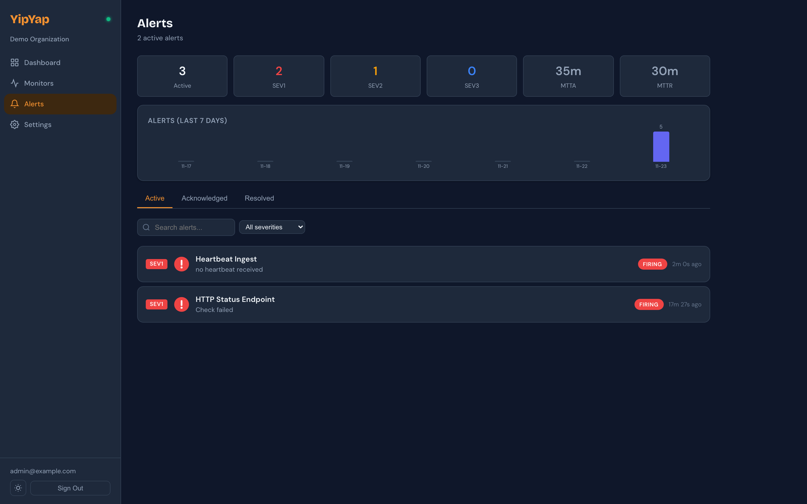

# YipYap Alerts - Open Source

Free, self-hosted monitoring and alerting for small teams. One binary, zero external dependencies.



## Features

- **HTTP, TCP, DNS, Ping, Heartbeat** health checks on configurable intervals
- **Escalation policies** with multi-step notification
- **Slack, Discord, Telegram, Email, Webhook, ntfy.sh, Pushover** notification channels
- **API key management** for automation and CI/CD integration
- **Multi-user** with role-based access (owner, admin, member, viewer)
- **Dashboard** with real-time monitor status, latency charts, uptime bars
- **Maintenance windows** with alert suppression
- **Custom monitor states** with per-monitor match rules
- **Monitor groups** for composite status rollup
- **Labels** for filtering and organizing monitors
- **Auto-resolve** to automatically close alerts when monitors recover
- **Monitor description** field for context and runbook notes
- **Mute/pause** to suppress notifications or stop checks entirely
- **Alert acknowledgment and resolution** workflow
- **SQLite** storage, single binary, zero external dependencies

## Quick Start

### Docker (recommended)

```bash
docker compose up -d
```

Open http://localhost:8080, register an account, and start adding monitors.

#### Non-root image and existing data volumes

The image runs as the unprivileged user `65534:65534` (nobody), not root. Its
working directory is `/data`, which is owned by that user, so a fresh named
volume mounted at `/data` is writable with no extra steps.

Data written by an older image that ran as root is owned by root, and the new
image cannot open it (the log shows a permission error on `yipyap.db` or
`jwt_secret`). Fix the ownership once before starting the new image:

```bash
docker compose stop yipyap

# Named volume (the default compose setup). The volume name is
# <project>_yipyap-data; `docker volume ls` shows it.
docker run --rm -v yipyap_yipyap-data:/data alpine:3 chown -R 65534:65534 /data

# Bind mount instead of a named volume:
sudo chown -R 65534:65534 ./data

docker compose up -d
```

On Kubernetes, set `securityContext.fsGroup: 65534` on the pod so the volume
is group-writable by the container user, or run the same `chown` once from an
init container.

Ping monitors use an unprivileged ICMP socket, so the container needs no extra
capabilities. Docker, Podman and containerd 2.x allow this by default. On an
older containerd, set the pod sysctl `net.ipv4.ping_group_range` to
`"0 2147483647"`.

### From Source

```bash
# Build
go build -o yipyap ./cmd/yipyap

# Run
# Run. With YIPYAP_JWT_SECRET unset, a secret is generated on first boot and
# stored next to the database (./jwt_secret here).
./yipyap
```

### Development

```bash
# Seed with mock data
YIPYAP_DEV_SEED=true go run ./cmd/yipyap
```

Credentials are printed to the console on first run (randomly generated password).

## Configuration

| Variable | Default | Description |
|----------|---------|-------------|
| `YIPYAP_LISTEN` | `:8080` | HTTP listen address |
| `YIPYAP_DB_DSN` | `yipyap.db` | SQLite database file path |
| `YIPYAP_JWT_SECRET` | (generated) | JWT signing secret, at least 32 bytes. When unset, a random secret is generated on first boot and stored in `jwt_secret` in the data dir (mode 0600), then reused. Back that file up with the database: losing it signs everyone out. Known placeholder values and anything shorter than 32 bytes are refused at startup. |
| `YIPYAP_DATA_DIR` | directory of `YIPYAP_DB_DSN` | Where the generated `jwt_secret` file lives (`/data` in the Docker image) |
| `YIPYAP_JWT_EXPIRY` | `24h` | JWT token expiry |
| `YIPYAP_NOTIFICATION_KEY` | (none) | Hex-encoded 32-byte AES-256 key for encrypting notification channel configs |
| `YIPYAP_REGISTRATION_ENABLED` | `true` | Allow new org+user registration |
| `YIPYAP_DEV_SEED` | `false` | Populate database with mock development data |
| `YIPYAP_MAX_MONITORS_PER_ORG` | (no cap) | Optional cap on monitors per organization |
| `YIPYAP_MAX_NOTIFICATION_CHANNELS_PER_ORG` | (no cap) | Optional cap on notification channels per organization |
| `YIPYAP_MIN_CHECK_INTERVAL_SECONDS` | `10` | Shortest check interval a monitor may use |

The open source build has no plan limits. The caps above are off unless you
set them. When a user hits one, the error names the variable so they know
who to ask.

## How people get paged

Escalation steps page people. Each user adds their own contact methods
under Settings, Contact Methods (email, ntfy, Pushover, Slack DM, Discord
DM, Telegram), verifies them with a code, and sets notification rules: which method,
after how many minutes, for which alerts. Rules still waiting are dropped
once the alert is acknowledged. A step target can also post to a shared
notification channel as an extra destination.

Step options: wait time, repeat pages, page targets at once or one after
another, and stop escalating at a step.

## Notification Channels

All channels are configured through the web UI under Settings → Notification Channels.

| Channel | Configuration |
|---------|---------------|
| **Email (SMTP)** | Host, port, username, password, from/to addresses |
| **Webhook** | URL, method, custom headers |
| **Slack** | Bot token + channel ID |
| **Discord** | Bot token + channel ID (webhook URL supported as fallback) |
| **Telegram** | Platform bot token (`YIPYAP_TELEGRAM_BOT_TOKEN`) and webhook secret; each chat is linked with a one-time `/link CODE` from Settings, Channels |
| **ntfy.sh** | Server URL + topic |
| **Pushover** | API token + user key |

## Contributing

Contributions welcome! See [CONTRIBUTING.md](CONTRIBUTING.md) for setup instructions, code style, and guidelines.

## License

[AGPL-3.0](LICENSE)

## YipYap Pro & Enterprise

Need more? [YipYap Pro](https://yipyap.run/pricing) adds:

- Teams and on-call scheduling with rotation
- Escalation loops and advanced retry policies
- SSO / OIDC authentication
- SMS and voice call notifications
- Public status pages
- OpenTelemetry metrics export

[Learn more at yipyap.run](https://yipyap.run)
